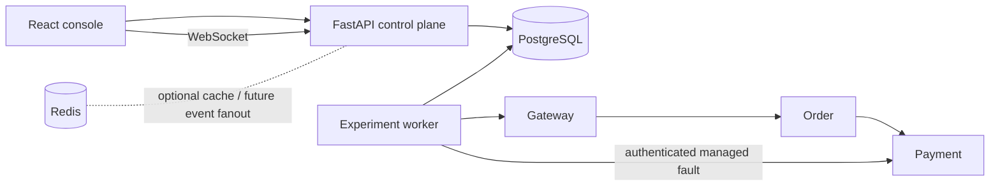

# FaultLab

FaultLab is a controlled resilience-testing platform for a three-service demo path: **gateway → order → payment**. It sends bounded traffic, changes only the managed payment service, measures baseline/fault/recovery windows, and stores an auditable experiment history. The React console shows live state, metrics, and a deterministic report.

> **Current status:** This is a working local prototype verified with a real-process HTTP lifecycle test. Terraform was statically validated; Docker and AWS deployment remain unverified. See [Known limitations](#known-limitations).

## Why it exists

Distributed failures often propagate through timeout and dependency boundaries. FaultLab makes those effects measurable in a safe, repeatable demo environment. It does not accept arbitrary targets or shell commands.

## Architecture



PostgreSQL is authoritative. WebSockets poll persisted state and can reconnect without losing the experiment. Redis is present for future fanout, but the current lifecycle does not depend on it. Each service propagates `X-Request-ID` and writes structured JSON logs.

## Stack

Python 3.12, FastAPI, Pydantic, SQLAlchemy, Alembic, PostgreSQL, Redis, React, TypeScript, React Router, TanStack Query, Recharts, Docker Compose, GitHub Actions, and Terraform.

## Lifecycle

`CREATED → BASELINE → FAULT_INJECTION → RECOVERY → COMPLETED`. Any nonterminal phase can end in `FAILED` or `CANCELLED`. Illegal transitions raise an error. Every phase change creates a sequenced `ExperimentEvent`.

## Supported faults

| Fault | Mechanism | Bounds |
|---|---|---|
| Downstream latency | Async delay in payment | 0–1000 ms |
| Downstream HTTP errors | Deterministic request-ID hash | 0–100% |
| Request timeout | Payment delay exceeding order timeout | 200–1000 ms |
| Dependency unavailable | Payment returns 503 | Managed demo only |
| CPU pressure | 50 ms bounded hash loop in payment | Managed demo only |

Container termination, resource limits, arbitrary network disruption, database outage, and Redis outage injection are **not implemented** as FaultLab fault types. See `docs/failure-model.md` for reproducible manual failure tests.

## Metrics and report

One-second snapshots contain requests/sec, success/error/timeout rates, status counts, connection errors, p50/p95/p99, successes, and failures. Percentiles use raw request latencies in each window. A final score combines availability, latency amplification, error amplification, and recovery; see `docs/resilience-score.md`.

## Local installation

1. Copy `.env.example` to `.env` and replace `INTERNAL_TOKEN` with a long random value.
2. Run `docker compose up --build` from this directory.
3. Open `http://localhost:8080`.
4. On **Services**, register the demo gateway once.
5. Create an experiment and watch its detail page.

The compose stack includes database migration as a required startup job and a persistent database volume. Ports for PostgreSQL, Redis, and demo services are not published to the host. To stop: `docker compose down`; to remove test data: `docker compose down -v`.

## API example

```bash
curl -X POST http://localhost:8080/api/services -H 'Content-Type: application/json' -d '{"name":"gateway"}'
curl http://localhost:8080/api/services
```

Use the returned service ID:

```bash
curl -X POST http://localhost:8080/api/experiments -H 'Content-Type: application/json' -d '{"service_id":"SERVICE_ID","requests_per_second":10,"concurrency":5,"baseline_seconds":30,"fault_seconds":40,"recovery_seconds":30,"timeout_seconds":1,"fault":{"type":"latency","latency_ms":300}}'
curl -X POST http://localhost:8080/api/experiments/EXPERIMENT_ID/start
```

## Tests and CI/CD

```bash
python -m pip install -e '.[test]'
python -m pytest -q
ruff check faultlab demo tests
mypy faultlab demo --ignore-missing-imports
cd frontend && npm ci && npm run lint && npm run typecheck && npm run test && npm run build
```

CI runs backend checks, tests (including a real-process lifecycle test), a SQLite migration smoke test, frontend lint/typecheck/tests/build, a dependency audit, and Docker image builds. CI has **not been run** against a remote GitHub repository. The full requested failure matrix has not been automated; `docs/testing.md` records coverage and reproducible manual procedures.

## Benchmarks

`docs/benchmarks/run.py` provides a reproducible scenario runner using the API. Run it after `docker compose up --build` and registering the gateway:

```bash
python docs/benchmarks/run.py --base-url http://localhost:8080 --service-id SERVICE_ID --output docs/benchmarks/results/local.json
```

No measured numbers are committed. Results depend on the host and date.

## AWS and Terraform

`infrastructure/terraform/` defines the ECS/Fargate, ECR, RDS, Redis, ALB, CloudWatch, IAM, network, and secret layout. `terraform fmt` and `terraform validate` passed locally. AWS plan/apply were **not performed**. See `docs/aws.md` for exact init, plan, apply, image push, and destroy commands. Do not represent this as deployed infrastructure.

## Safety boundaries

- Only the fixed `gateway` registration is accepted; URLs are resolved from trusted environment configuration.
- Fault changes use an internal token and only affect the managed payment process.
- Requests are limited to 50/sec, 20 concurrent, and 300 seconds per phase.
- No arbitrary container name, host, command, IP, or URL can be supplied through the API.
- One active experiment per registered service is the intended policy. See `docs/adr/0008-concurrency.md` for the remaining race limitation.

## Engineering decisions

See `docs/adr/` and `docs/architecture.md`. PostgreSQL holds state and events; the worker owns execution; WebSockets are a projection of persisted data. Metrics are per-window to keep raw observations transient.

## Known limitations

- The repository has passed a local real-process lifecycle test, but has not been executed in Docker or AWS in this environment.
- Worker lease reconciliation marks orphaned experiments failed and attempts cleanup; a repeated cleanup failure needs operator action.
- Redis is provisioned but unused in the runtime path, so Redis reconnection behavior has not been validated.
- There is no authentication for the UI/API; bind the console only to a trusted local development environment.
- A database-backed active-service lock is needed before scaling workers or accepting concurrent starts from several API instances.
- Broad failure integration tests, screenshots/GIF, cloud deployment, and verified benchmarks remain outstanding.
